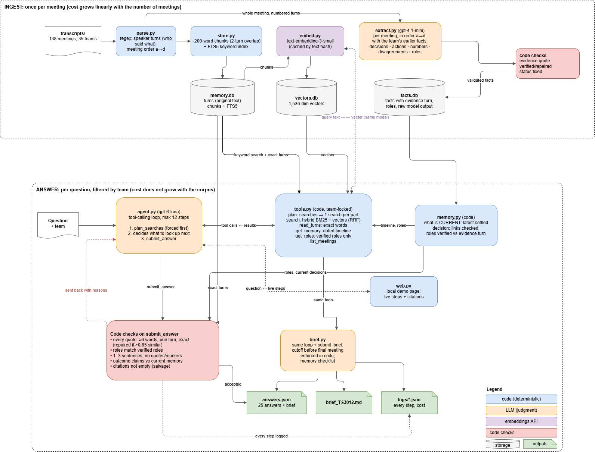

# Meeting memory agent (Catalist build test)

An agent that turns 138 meeting transcripts (AMI corpus) into memory it can query, answers
questions with exact, code-verified citations, and writes a pre-meeting brief.

## Deliverables

| Asked for | Where it is |
|---|---|
| Code + README on how to run it | this repo (`src/`, `tests/`, this file) |
| Answers to the 25 questions + TS3012 brief | `answers.json` (brief also in `brief_TS3012.md`) |
| One-page write-up | submitted as a PDF (`WRITEUP.md` is a Markdown version) |
| Architecture diagram | `build_test.png` (shown below) |
| 3-5 min walkthrough | video link submitted separately |
| Build log (extra) | `NOTES.md`: every measurement and decision |



## How it works

```
transcripts/*.txt
  │  parse.py        split into speaker turns (regex), meeting order a=1..d=4      [code]
  │  store.py        SQLite: meetings, turns (original text), ~200-word chunks,     [code]
  │                  keyword index (FTS5 / BM25)
  │  embed.py        chunk embeddings, text-embedding-3-small                        [OpenAI]
  │  extract.py      per meeting, in order a->d with the team's earlier facts:       [LLM + code checks]
  │                  decisions / actions / numbers / disagreements / roles,
  │                  each with a verified evidence quote
  ▼
data/memory.db  data/vectors.db  data/facts.db
  │
  │  agent.py        tool-calling loop (gpt-6-luna): plan_searches (forced first:       [LLM decides,
  │                  code runs one search per part), list_meetings, get_roles,          code executes
  │                  get_memory (dated timeline), search (hybrid), read_turns,          and checks]
  │                  submit_answer -> code checks quotes, roles, format, and outcome
  │                  claims against memory's current decisions; strips citation markers
  │  brief.py        same loop, meetings before the final one only (enforced in code)
  ▼
answers.json  brief_TS3012.md  logs/<question>.json (every step of every answer)
```

## Setup

Python 3.11+ (built on 3.15).

```
python -m venv .venv
.venv\Scripts\Activate.ps1        (Windows)   |   source .venv/bin/activate   (Mac/Linux)
pip install -r requirements.txt
```
Create a file `.env` in this folder with one line: `OPENAI_API_KEY=sk-...` (never committed).

## Run it (in this order)

| Step | Command | Time | Cost |
|---|---|---|---|
| 1. Build the store | `python src/store.py` | ~1 s | free |
| 2. Embeddings | `python src/embed.py` | ~40 s | ~$0.03 |
| 3. Extract memory | `python src/extract.py --all` | ~11 min | ~$1.03 |
| 4. Answer the 25 questions | `python src/run_questions.py` | ~2-3 min | ~$0.12 |
| 5. TS3012 brief | `python src/brief.py` | ~1 min | ~$0.02 |

Steps 2 and 3 are resumable and never pay twice for the same work. Memory extraction uses
gpt-4.1-mini; the agent and brief use gpt-6-luna (set `AGENT_MODEL=gpt-4.1-mini` in the
environment to compare). `python src/run_questions.py --clean` re-applies the answer clean-up
to an existing answers.json without calling any model.

Demo page (live steps, answer with citations, the brief):
```
python src/web.py        then open http://127.0.0.1:8000
```

Ask anything in the terminal:
```
python src/agent.py TS3012 "What case material did they choose and why?"
```

Look around without the LLM:
```
python src/memory.py TS3012 lcd          timeline of LCD decisions
python src/search.py TS3012 "kinetic"    hybrid search
python src/inspect_data.py show TS3012c 56
```

## Evaluation

| Command | What it measures |
|---|---|
| `python tests/check_quotes.py` | our 10 test questions' citations are real (grader's rules) |
| `python tests/eval_search.py` | retrieval recall@k: keyword vs vector vs hybrid |
| `python tests/eval_memory.py` | extracted memory vs 14 TS3012 moments checked by reading |
| `python tests/eval_current.py` | does memory know the FINAL state? 12 hand-checked outcomes (free, deterministic) |
| `python tests/eval_agent.py` | agent on our 10 development questions: key facts, citations, cost |
| `python tests/eval_agent.py --heldout` | agent on 6 held-out questions (5 teams no other question set uses) |
| `python tests/check_quotes.py --heldout` | the held-out set's citations are real |

`tests/my_questions.json` holds 10 questions on 6 teams that are not in Catalist's 25;
`tests/heldout_questions.json` holds 6 more on the last 5 unused teams. All answers were written by
reading the transcripts; all 48 citations are code-verified. Key-fact scores come from an LLM judge
(gpt-4.1-mini) that was checked by reading; see WRITEUP.md for both numbers.

## Files

| File | Role |
|---|---|
| `src/explore.py`, `src/inspect_data.py` | data exploration, reading helper |
| `src/parse.py` | the one parser + search normalisation (L_C_D_ -> LCD, number words -> digits) |
| `src/store.py`, `src/search.py`, `src/embed.py` | storage and hybrid search |
| `src/prompts.py` | all prompts, versioned |
| `src/extract.py`, `src/memory.py` | memory extraction, timelines and "what is current" |
| `src/tools.py`, `src/verify.py`, `src/agent.py` | the agent: tools, citation checks, loop |
| `src/run_questions.py`, `src/brief.py` | answers.json |
| `src/web.py` | local demo page (standard library only) |

Data: AMI Meeting Corpus (University of Edinburgh and partners), CC BY 4.0.
